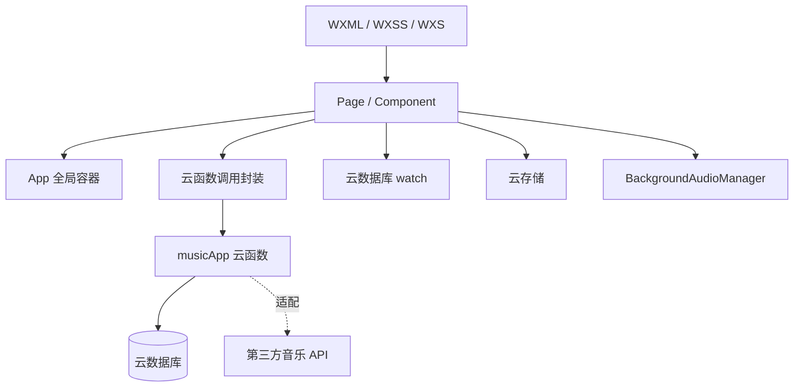
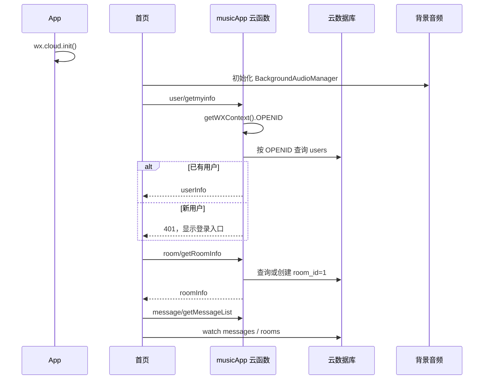
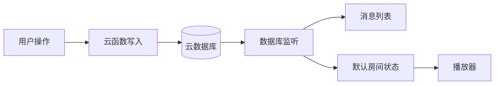

# 整体架构

## 逻辑分层



### 应用层

`app.js` 负责版本检查、系统信息、动态初始化 `wx.cloud`、共享用户与默认房间状态，以及暴露 `app.request`。

### 页面层

首页负责聊天、播放器和实时监听；歌曲页负责搜索、队列、歌曲收藏和儿歌乐园（内置分类曲库，点击后按关键词搜索网易云取第一首点播）；用户页负责微信登录和资料。

### 云服务层

- `utils/request.js`：把原业务动作封装为 `wx.cloud.callFunction`。
- `cloudfunctions/musicApp/index.js`：服务端业务路由、身份识别、校验和数据库写入。
- 云数据库：持久化用户、默认房间、消息、队列和歌曲收藏。
- 云存储：保存用户头像、聊天图片和语音。

## 启动流程



## 实时架构



发消息时客户端先插入临时消息，云函数写入成功后 `messages.watch()` 返回正式数据并替换页面列表。切歌时云函数更新 `rooms.current_song`，`rooms.watch()` 驱动各客户端同步播放器。

## 状态管理

| 状态位置 | 内容 |
| --- | --- |
| `app.globalData` | `userInfo`、`roomInfo`、`atUserInfo`、`user_changed` |
| 首页 `data` | 消息、输入框、歌曲、歌词、播放器和监听器 |
| 云数据库 | 用户、默认房间、消息、队列、收藏 |

页面间使用 EventChannel 传递驾驶模式操作结果。

## 关键数据流

### 微信身份

```text
首页先读取本地缓存的用户资料，再静默调用 user/getmyinfo
→ 云函数读取 OPENID 并查询已有用户
→ 已有用户直接加载资料并刷新缓存
→ 新用户显示登录入口
→ 勾选协议并选择头像后调用 weapp/wxAppLogin 创建用户
→ 登录成功写入缓存并通知需要登录数据的页面刷新
```

### 聊天发送

```text
输入消息
→ 本地 loading 消息
→ message/send 云函数
→ messages 集合新增
→ messages.watch
→ 正式消息列表
```

### 歌曲播放

```text
点歌或立即播放
→ play_queue 写入
→ rooms.current_song 更新
→ rooms.watch
→ playMusic
→ BackgroundAudioManager
```

### 自动补歌

```text
队列不足（目标 1~5 首，默认 3）
→ refill_lock_until 抢占 15 秒锁
→ 客户端通过 WS 搜索候选：正常模式抽 1 个提示词；儿歌模式抽 1 聚合词 + 2 歌名词
→ 云函数并行准备：我的歌曲收藏 / rooms.backup_songs 缓存 / 客户端 candidates
→ 候选随机打乱，排除当前队列和 recent_played（最近 20 首已播；儿歌模式不排除）
→ 结构校验后按权重随机混入 play_queue（正常 收藏:缓存:提示词 = 5:3:2；儿歌 收藏:词池 = 3:2）（auto_added + backup_source 标记）
→ 队列排空时置 auto_refill_paused
```

触发途径包括切歌（`song/pass`、`song/ended`）、显式调用 `song/refill` 和定时触发器 `refillPlaybackQueue`。

### 儿歌模式（一键儿歌）

任意登录用户经 `room/setChildrenMode` 开启：`children_mode` 置位 → 待播队列清空 → 优先取「儿歌」收藏；没有收藏时云函数返回 `has_song: false`，由客户端通过 WS 搜索首曲。此后自动补歌来自「儿歌收藏」与客户端 WS 词池候选（每次抽 1 个聚合词 + 2 个具体歌名词）两个来源按权重 3:2 混入，儿歌模式下不排除最近已播歌曲。关闭时复位开关并清空待播队列（与开启对称），当前歌曲播完后回到正常补歌。儿歌页底部按钮为入口，首页播放器开启后转为彩色跑马灯特效形态。

## 设计约束

- 当前只有 `room_id = 1` 的默认房间。
- 首位创建默认房间的用户成为唯一房主；立即播放、置顶、清空消息和提示词管理仅限房主，移除队列歌曲限房主或点歌人，撤回消息限发送者或房主，切歌对所有登录用户开放。
- 客户端允许读取实时集合，但不能直接写数据库。
- OPENID 只在云函数中使用，不返回客户端。
- 所有平台的歌曲、歌单、用户和电台搜索，以及点歌播放直链，都依赖 jusic-serve WebSocket（`/music/search`、`/music/songlist`、`/music/searchuser`、`/music/pick`）；网易云歌词由云函数请求网易云官方歌词接口，不再依赖 Meting-API。酷狗入口隐藏，历史来源标识保留但无法重新获取播放地址。
- 子页面依赖首页已初始化 `app.globalData.userInfo` 和 `roomInfo`。
